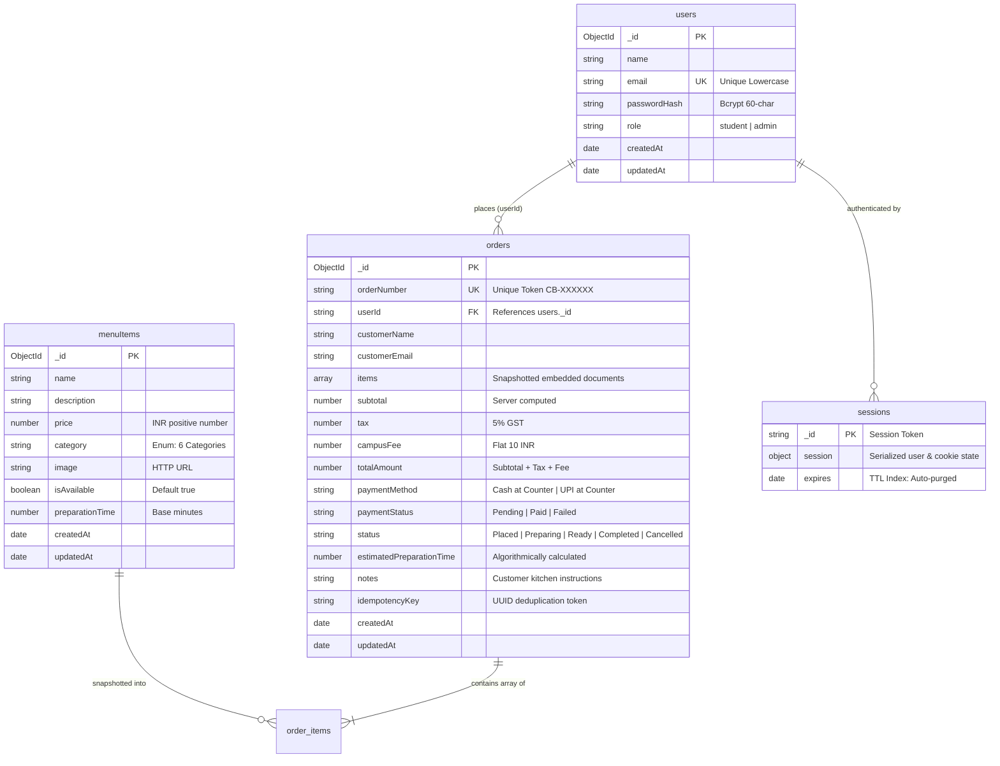

# CampusBite — Database Design & Data Modeling Specification

This document details the MongoDB Atlas database schema, collection architectures, indexing strategies, relationship models, and data persistence lifecycles implemented in **CampusBite**.

---

## 1. Database Overview

CampusBite uses **MongoDB Atlas**, a cloud-hosted document database, connected via the official native MongoDB Node.js driver (`mongodb@7.8.0`). In accordance with **CSE326** academic constraints, no Object-Document Mapping (ODM) libraries such as Mongoose are used; all queries, projections, updates, and indexing commands are issued directly using native driver methods (`insertOne`, `find`, `findOneAndUpdate`, `createIndex`).

- **Database Name**: `campusbite` (configurable via `DB_NAME` in `.env`).
- **Primary Collections**:
  1. `users` — Student and administrator identity records.
  2. `menuItems` — Canteen food and beverage catalog.
  3. `orders` — Customer orders with immutable item price snapshots.
  4. `sessions` — Production session documents managed via `connect-mongo`.

---

## 2. Entity-Relationship Model



---

## 3. Collection Specifications

### 3.1 `users` Collection

Stores credentials and role metadata for students and staff.

| Field | Type | Required | Constraints / Validation | Description |
|---|---|:---:|---|---|
| `_id` | `ObjectId` | Yes | Auto-generated 12-byte BSON identifier | Primary Key |
| `name` | `String` | Yes | Minimum 2 characters, trimmed | Display name of student/admin |
| `email` | `String` | Yes | Unique index, lowercase normalized | University email address |
| `passwordHash` | `String` | Yes | 60-character bcrypt hash (`$2a$10$...`) | Encrypted password |
| `role` | `String` | Yes | Enum: `['student', 'admin']` | Authorization role (default: `'student'`) |
| `createdAt` | `Date` | Yes | ISO 8601 UTC timestamp | Record creation time |
| `updatedAt` | `Date` | Yes | ISO 8601 UTC timestamp | Record modification time |

#### Sanitized Sample Document (`users`)
```json
{
  "_id": { "$oid": "6af0af38f9231151a5f06ce6" },
  "name": "Aarav Patel",
  "email": "aarav.patel@campusbite.edu",
  "passwordHash": "$2a$10$7vN30wBwL.X1YvK4uK9gUe7hQ8oJ2lR9pM4mK6vW9yZ8qT0sP1a.",
  "role": "student",
  "createdAt": { "$date": "2026-11-08T16:53:11.227Z" },
  "updatedAt": { "$date": "2026-11-08T16:53:11.227Z" }
}
```

---

### 3.2 `menuItems` Collection

Stores the current menu items offered by the canteen.

| Field | Type | Required | Constraints / Validation | Description |
|---|---|:---:|---|---|
| `_id` | `ObjectId` | Yes | Auto-generated BSON identifier | Primary Key |
| `name` | `String` | Yes | Minimum 2 characters, trimmed | Name of the dish |
| `description` | `String` | No | String | Ingredients & culinary details |
| `price` | `Number` | Yes | Float / Integer > 0 (INR) | Authoritative selling price |
| `category` | `String` | Yes | Enum: `['Burgers', 'Pizza', 'Snacks', 'Indian Food', 'Beverages', 'Desserts']` | Menu category tab |
| `image` | `String` | No | URL string | Image resource link |
| `isAvailable` | `Boolean` | Yes | Boolean (default: `true`) | Stock availability flag |
| `preparationTime`| `Number` | Yes | Integer >= 1 (default: 10) | Single-portion cooking time (mins) |
| `createdAt` | `Date` | Yes | ISO 8601 UTC timestamp | Record creation time |
| `updatedAt` | `Date` | Yes | ISO 8601 UTC timestamp | Record modification time |

#### Sanitized Sample Document (`menuItems`)
```json
{
  "_id": { "$oid": "672e19b52a1b9c3f8e4d1001" },
  "name": "Paneer Makhani Burger",
  "description": "Crispy spiced cottage cheese patty topped with rich butter makhani sauce and iceberg lettuce.",
  "price": 129,
  "category": "Burgers",
  "image": "https://images.unsplash.com/photo-1568901346375-23c9450c58cd?auto=format&fit=crop&w=600&q=80",
  "isAvailable": true,
  "preparationTime": 12,
  "createdAt": { "$date": "2026-11-08T10:00:00.000Z" },
  "updatedAt": { "$date": "2026-11-08T10:00:00.000Z" }
}
```

---

### 3.3 `orders` Collection

Stores customer orders with embedded, immutable item price snapshots to preserve historical accuracy even if menu prices change later.

| Field | Type | Required | Constraints / Validation | Description |
|---|---|:---:|---|---|
| `_id` | `ObjectId` | Yes | Auto-generated BSON identifier | Primary Key |
| `orderNumber` | `String` | Yes | Unique index, pattern `CB-XXXXXX` | Human-readable token |
| `userId` | `String` | Yes | String representation of `users._id` | Customer ID |
| `customerName` | `String` | Yes | String | Customer display name |
| `customerEmail`| `String` | No | String | Customer email address |
| `items` | `Array` | Yes | Non-empty array of item objects | Frozen snapshot of ordered dishes |
| `subtotal` | `Number` | Yes | Sum of `item.price * quantity` | Pre-tax items total |
| `tax` | `Number` | Yes | `subtotal * 0.05` | 5% Goods and Services Tax |
| `campusFee` | `Number` | Yes | Flat ₹10 (if subtotal > 0) | Campus convenience charge |
| `totalAmount` | `Number` | Yes | `subtotal + tax + campusFee` | Grand final payable total |
| `paymentMethod`| `String` | Yes | Enum: `['Cash at Counter', 'UPI at Counter']` | Selected counter payment |
| `paymentStatus`| `String` | Yes | Enum: `['Pending', 'Paid', 'Failed']` | Settlement state |
| `status` | `String` | Yes | Enum: `['Placed', 'Preparing', 'Ready', 'Completed', 'Cancelled']` | Lifecycle state |
| `estimatedPreparationTime`| `Number` | Yes | Integer `[5, 45]` | Estimated minutes |
| `notes` | `String` | No | String | Kitchen instructions |
| `idempotencyKey`| `String` | No | Sparse compound indexed string | Client checkout UUID |
| `createdAt` | `Date` | Yes | ISO 8601 UTC timestamp | Placement timestamp |
| `updatedAt` | `Date` | Yes | ISO 8601 UTC timestamp | Status change timestamp |

#### Embedded Items Sub-Document Structure
Each element inside `orders.items` contains:
```json
{
  "menuItemId": "672e19b52a1b9c3f8e4d1001",
  "name": "Paneer Makhani Burger",
  "price": 129,
  "category": "Burgers",
  "quantity": 2,
  "preparationTime": 12
}
```

#### Sanitized Sample Document (`orders`)
```json
{
  "_id": { "$oid": "672e3a89e1a90c1f2b4e8891" },
  "orderNumber": "CB-849201",
  "userId": "6af0af38f9231151a5f06ce6",
  "customerName": "Aarav Patel",
  "customerEmail": "aarav.patel@campusbite.edu",
  "items": [
    {
      "menuItemId": "672e19b52a1b9c3f8e4d1001",
      "name": "Paneer Makhani Burger",
      "price": 129,
      "category": "Burgers",
      "quantity": 2,
      "preparationTime": 12
    },
    {
      "menuItemId": "672e19b52a1b9c3f8e4d1007",
      "name": "Thick Cold Coffee with Ice Cream",
      "price": 85,
      "category": "Beverages",
      "quantity": 1,
      "preparationTime": 6
    }
  ],
  "subtotal": 343,
  "tax": 17.15,
  "campusFee": 10,
  "totalAmount": 370.15,
  "paymentMethod": "UPI at Counter",
  "paymentStatus": "Paid",
  "status": "Completed",
  "estimatedPreparationTime": 18,
  "notes": "Extra napkins please",
  "idempotencyKey": "9b1deb4d-3b7d-4bad-9bdd-2b0d7b3dcb6d",
  "createdAt": { "$date": "2026-11-08T13:15:30.000Z" },
  "updatedAt": { "$date": "2026-11-08T13:32:10.000Z" }
}
```

---

### 3.4 `sessions` Collection

Managed by `connect-mongo` for secure Express session storage across server restarts.

| Field | Type | Description |
|---|---|---|
| `_id` | `String` | Raw session ID |
| `session` | `Object` | Serialized session data containing cookie attributes and `user: { id, name, email, role }` |
| `expires` | `Date` | Automatically indexed with a TTL of 86400 seconds (24 hours) |

#### Sanitized Sample Document (`sessions`)
```json
{
  "_id": "s:k9L0PqR3sTuVwXyZ1a2b3c4d5e6f7g8h.ABCDEF1234567890",
  "session": {
    "cookie": {
      "originalMaxAge": 86400000,
      "expires": "2026-11-09T16:53:11.000Z",
      "httpOnly": true,
      "sameSite": "lax",
      "path": "/"
    },
    "user": {
      "id": "6af0af38f9231151a5f06ce6",
      "name": "Aarav Patel",
      "email": "aarav.patel@campusbite.edu",
      "role": "student"
    }
  },
  "expires": { "$date": "2026-11-09T16:53:11.000Z" }
}
```

---

## 4. Indexing & Optimization Strategy

The indexes created in `scripts/init-db.js` optimize query performance:

| Collection | Key(s) | Type / Options | Purpose |
|---|---|---|---|
| `users` | `{ email: 1 }` | `unique: true` | Enforces unique email addresses and speeds up authentication lookup. |
| `menuItems` | `{ category: 1 }` | Standard ascending | Accelerates category-based menu filtering on `/menu.html`. |
| `menuItems` | `{ isAvailable: 1 }` | Standard ascending | Optimizes queries fetching only available items. |
| `orders` | `{ orderNumber: 1 }` | `unique: true` | Guarantees uniqueness for customer order tokens and powers live tracking lookups. |
| `orders` | `{ userId: 1 }` | Standard ascending | Speeds up retrieval of a student's personal order history (`/api/orders/my`). |
| `orders` | `{ createdAt: -1 }` | Standard descending | Accelerates chronological sorting for admin order feeds and analytics. |
| `orders` | `{ status: 1 }` | Standard ascending | Powers active kitchen queue counting and status filtering. |
| `orders` | `{ userId: 1, idempotencyKey: 1 }` | `sparse: true` | Fast deduplication check preventing double-checkout submissions. |
| `sessions` | `{ expires: 1 }` | `expireAfterSeconds: 0` | Native MongoDB TTL index that automatically deletes expired session documents. |

---

## 5. Database Initialization & Seeding Pipelines

### Initialization (`scripts/init-db.js`)
- Executed via `npm run db:init`.
- Establishes a TLS connection to MongoDB Atlas.
- Verifies collection availability and builds all unique and sparse indexes safely using `createIndex()`.
- Idempotent and non-destructive: if indexes already exist, MongoDB confirms their presence without touching existing records.

### Seeding Pipeline (`scripts/seed-menu.js`)
- Executed via `npm run db:seed`.
- Populates the `menuItems` collection with 12 foundational dishes spanning all 6 categories.
- Uses `findOne({ name: item.name })` before inserting; existing items are preserved, preventing duplicate records on repeated script runs.
