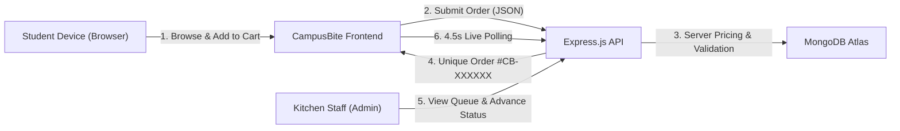
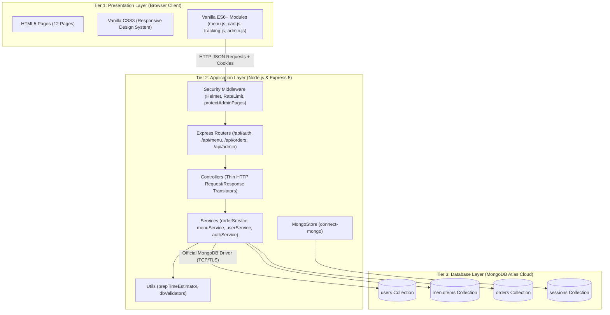
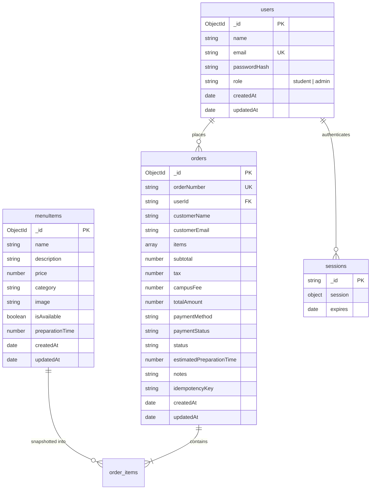
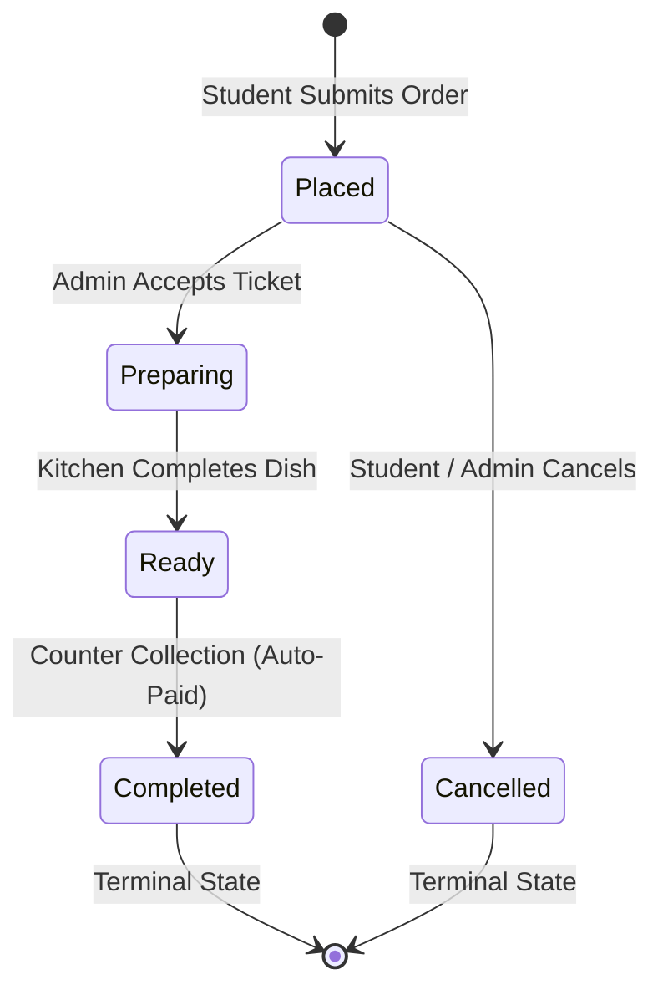

# CampusBite — Smart Canteen Ordering System
## CSE326 Academic Project Report

---

# 1. Cover Page

```
================================================================================
                               PROJECT REPORT
                                     ON
               CAMPUSBITE — SMART CANTEEN ORDERING SYSTEM

            Submitted in partial fulfillment of the requirements
                    for the award of the degree of
                     Bachelor of Technology in CSE
                    Course Code: CSE326 — Web Technology
================================================================================

SUBMITTED BY:
Name: Pirzada Salik
Registration Number: [Student Registration Number Placeholder]
Semester / Section: [Semester / Section Placeholder]

UNDER THE GUIDANCE OF:
Faculty Guide: [Faculty Mentor / Guide Name Placeholder]
Designation: [Assistant Professor / Associate Professor Placeholder]
Department: Department of Computer Science & Engineering
Institution: [University / Institute Name Placeholder]

ACADEMIC SESSION:
[2026 – 2027 Academic Session Placeholder]
================================================================================
```

---

# 2. Certificate

```
================================================================================
                                 CERTIFICATE
================================================================================

This is to certify that the project report entitled:

          "CAMPUSBITE — SMART CANTEEN ORDERING SYSTEM"

submitted by Pirzada Salik (Registration No.: [Registration Number Placeholder]) 
in partial fulfillment of the requirements for the course CSE326 (Web Technology) 
at [University / Institute Name Placeholder] is an authentic record of the 
bonafide work carried out under my supervision and guidance.

To the best of my knowledge, the matter embodied in this report has not been 
submitted to any other University or Institute for the award of any degree, 
diploma, or academic credit.


___________________________                    ___________________________
Project Guide / Faculty Mentor                 Head of Department
Department of Computer Science                 Department of Computer Science
Date: [Date Placeholder]                       Date: [Date Placeholder]
================================================================================
```

---

# 3. Declaration

```
================================================================================
                            CANDIDATE'S DECLARATION
================================================================================

I, Pirzada Salik, hereby declare that the project entitled "CampusBite — Smart 
Canteen Ordering System" submitted for the academic evaluation of course CSE326 
(Web Technology) is an original work done by me.

I confirm that:
1. The project implementation strictly adheres to the approved technology stack 
   (HTML5, CSS3, Vanilla JavaScript ES6+, Node.js, Express.js, and MongoDB Atlas 
   using the official MongoDB Node.js Driver).
2. No prohibited frameworks (React, Vue, Angular, TypeScript, JSX, Tailwind CSS, 
   Bootstrap, jQuery, or Mongoose) have been used.
3. The report presents the actual implementation, verified test suites, and 
   database schemas developed during the project lifecycle.
4. Any material taken from published literature, official documentation, or 
   standard references has been appropriately cited and acknowledged.


___________________________
Pirzada Salik
Date: [Date Placeholder]
Place: [Location Placeholder]
================================================================================
```

---

# 4. Acknowledgement

I express my deepest gratitude to my course instructor and faculty mentor, **[Faculty Guide Name Placeholder]**, for their constructive feedback, continuous encouragement, and valuable guidance throughout the conception, architecture design, and development of **CampusBite**.

I also extend my sincere appreciation to the Department of Computer Science & Engineering at **[University Name Placeholder]** for providing the computing infrastructure, laboratory resources, and academic environment necessary to complete this project.

Finally, I would like to thank my peers and family for their continuous moral support and insightful suggestions during testing and documentation.

— **Pirzada Salik**

---

# 5. Abstract

On modern academic campuses, university canteens and dining halls experience extreme demand spikes during short recess periods. The traditional operational paradigm—relying on manual physical queueing, verbal dish ordering, paper-based billing, and physical counter collection tokens—produces severe bottlenecks, order inaccuracies, inventory opacity, and extended wait times (frequently exceeding 25–30 minutes for a single meal).

To solve these inefficiencies, this project presents **CampusBite**, a full-stack Smart Canteen Ordering and Queue Management System engineered specifically under the academic constraints of **CSE326 (Web Technology)**. CampusBite utilizes a pure, framework-free client layer constructed in **HTML5, CSS3, and Vanilla JavaScript (ES6+)**, coupled with a high-performance **Node.js and Express.js** server layer and a cloud-hosted **MongoDB Atlas** database accessed exclusively via the **official MongoDB Node.js Driver** (zero ORM/Mongoose overhead).

CampusBite provides students with an interactive, categorized food catalogue, client-side search and category filtering, a persistent local cart with item quantity enforcement, and an authority-enforced checkout process. Client-submitted prices are discarded on the server to prevent price-manipulation vulnerabilities; the server computes accurate subtotals, a 5% Goods and Services Tax (GST), and a ₹10 campus convenience fee. Orders are assigned unique, collision-free identification tokens (`CB-XXXXXX`) and tracked through a 4-stage lifecycle (`Placed` ➔ `Preparing` ➔ `Ready` ➔ `Completed`) supported by a transparent preparation time estimation algorithm that dynamically accounts for kitchen backlog.

Canteen staff manage incoming tickets through a password-protected administrative dashboard featuring lifecycle state transition validation, counter payment settlement, real-time menu availability toggling, and business analytics (gross order value, collected counter revenue, and 7-day revenue trajectories). The system was validated through 41 automated integration tests, 8 end-to-end user workflows, and a 13-point live cloud database reliability audit, achieving 100% pass rates across all functional and security suites.

---

# 6. Table of Contents

1. Cover Page
2. Certificate
3. Declaration
4. Acknowledgement
5. Abstract
6. Table of Contents
7. Introduction
   - 7.1 Background
   - 7.2 Problem Identification
   - 7.3 Motivation
   - 7.4 Project Objectives
8. Existing System and Its Limitations
9. Proposed System
   - 9.1 Student Functionality
   - 9.2 Administrator Functionality
   - 9.3 System Advantages
10. Requirements Analysis
    - 10.1 Functional Requirements
    - 10.2 Non-Functional Requirements
    - 10.3 Hardware Requirements
    - 10.4 Software Requirements
11. System Architecture
    - 11.1 Three-Tier Architecture
    - 11.2 Presentation Layer
    - 11.3 Application & Business Logic Layer
    - 11.4 Database Layer
    - 11.5 Request-Response Lifecycle
12. Technology Stack
13. Database Design & Data Modeling
    - 13.1 Schema Design
    - 13.2 Collections & Document Structures
    - 13.3 Indexing Strategy
    - 13.4 Justification for MongoDB
14. Module Description
    - 14.1 Authentication & Session Management
    - 14.2 Menu Catalogue & Search
    - 14.3 Persistent Shopping Cart
    - 14.4 Order Engine & Checkout
    - 14.5 Live Order Tracking
    - 14.6 Student Order History & Cancellation
    - 14.7 Admin Operations Command Center
    - 14.8 Menu Catalog Management
    - 14.9 Order Dispatch & State Machine
    - 14.10 Sales Telemetry & Analytics
15. Important Algorithms and Business Logic
    - 15.1 Server-Side Price & Tax Enforcement
    - 15.2 Idempotency & Duplicate Order Prevention
    - 15.3 Unique Order Token Generation
    - 15.4 Order Status State Machine
    - 15.5 Smart Kitchen Preparation Time Estimation Formula
    - 15.6 Revenue Calculation Engine
16. Security Implementation
17. Testing and Results
    - 17.1 Testing Strategy
    - 17.2 Integration & Unit Test Suite (41 Tests)
    - 17.3 End-to-End User Journeys (8 Workflows)
    - 17.4 Live Cloud Atlas Reliability Audit (13 Steps)
18. Screenshots & User Interface Walkthrough
19. Limitations of the System
20. Future Scope & Roadmap
21. Conclusion
22. References

---

# 7. Introduction

## 7.1 Background
University canteens serve thousands of students, faculty, and administrative staff daily within compressed time windows (typically 45–60 minute lunch breaks). In this high-density environment, food service operations must be rapid, accurate, and transparent. While enterprise food-delivery platforms (such as Zomato or Swiggy) cater to citywide commercial logistics, campus dining requires a specialized, low-latency, localized solution that operates within university network boundaries, supports counter collection, and does not require expensive third-party commission structures.

## 7.2 Problem Identification
Observations of traditional campus canteen workflows reveal several persistent friction points:
1. **Physical Counter Congestion**: Over 80% of dining break time is spent waiting in order and payment queues rather than dining.
2. **Order Discrepancies**: Verbal communication over busy counters results in incorrect dish preparation, dietary mix-ups, and customer dissatisfaction.
3. **Queue Invisibility**: Students cannot assess kitchen congestion prior to walking to the canteen, leading to erratic crowd surges.
4. **Counter Cash & UPI Reconciliation Delays**: Kitchen staff must alternate between cooking, handling cash, and visually checking UPI receipts on mobile screens, creating hygiene and efficiency concerns.

## 7.3 Motivation
The primary motivation behind CampusBite is to apply foundational web engineering principles—standards-based HTML5, CSS3, modern ES6+ JavaScript, asynchronous server architectures with Node.js/Express, and cloud NoSQL databases—to construct a production-ready software solution for an everyday campus challenge, without relying on opaque commercial frameworks.

## 7.4 Project Objectives
The core objectives of the CampusBite project are:
- **Zero-Queue Ordering**: Enable students to pre-order meals from their personal devices before arriving at the canteen.
- **Server-Side Financial Integrity**: Eliminate client-side price tampering by computing all prices, taxes (5% GST), and fees (₹10 campus fee) strictly on the server.
- **Transparent Kitchen Telemetry**: Provide a deterministic preparation time algorithm reflecting dish complexity and kitchen workload.
- **State Machine Enforcement**: Enforce a strict lifecycle transition model (`Placed` ➔ `Preparing` ➔ `Ready` ➔ `Completed`).
- **Academic Rigor**: Complete the entire stack without any prohibited frontend frameworks, build systems, or object-relational mapping (ORM) libraries.

---

# 8. Existing System and Its Limitations

The existing canteen management model in most collegiate institutions is largely manual or relies on rudimentary standalone billing machines.

| Parameter | Existing Traditional System | CampusBite Smart System |
|---|---|---|
| **Ordering Channel** | Physical counter queue with verbal ordering | Remote digital ordering via responsive web application |
| **Menu Visibility** | Static blackboard or physical printed paper menu | Real-time dynamic web catalog with stock availability status |
| **Pricing Calculation** | Manual counter entry on keypad | Automated server-side calculation with item snapshots |
| **Wait Time Estimation** | Vague verbal estimate from counter staff ("10 minutes") | Algorithmic estimate factoring dish prep time + kitchen queue |
| **Order Tracking** | Paper token numbers shouted over dining room noise | Visual 4-stage tracking stepper with periodic polling updates |
| **Cancellation** | Difficult; requires verbal arguing with kitchen staff | Self-service one-click cancellation while in `Placed` status |
| **Inventory Control** | Kitchen runs out mid-cook; manual refund friction | Real-time "Sold Out" toggle prevents ordering unavailable items |
| **Sales Analytics** | Handwritten paper logs or end-of-day register prints | Real-time dashboard showing gross volume and collected revenue |

---

# 9. Proposed System

CampusBite replaces physical dining queues with an automated, browser-accessible digital ordering ecosystem.



## 9.1 Student Functionality
- Account creation with email normalization and secure bcrypt password hashing.
- Category-based menu browsing (Burgers, Pizza, Snacks, Indian Food, Beverages, Desserts).
- Live keyword search across dish names and descriptions.
- Persistent client-side cart stored in `localStorage` with quantity constraints (1–20 units).
- Checkout with counter-based payment selection ("Cash at Counter" or "UPI at Counter").
- Real-time visual progress stepper for placed orders (`Placed` ➔ `Preparing` ➔ `Ready` ➔ `Completed`).
- Self-cancellation allowed exclusively before kitchen preparation begins.

## 9.2 Administrator Functionality
- Secure administrative login with role verification and automatic route redirection.
- Real-time order dispatch feed filterable by status, date, or customer query.
- Strict order lifecycle advancement with invalid transition rejection.
- Counter payment settlement tracking with automatic payment reconciliation on order completion.
- Complete menu item management (Create, Read, Update price/availability, Delete).
- Financial telemetry dashboard displaying gross order value, collected cash/UPI revenue, active kitchen queue count, and 7-day revenue charts.

## 9.3 System Advantages
- **Time Savings**: Reduces average student dining turnaround from 35 minutes to under 10 minutes.
- **Error Elimination**: Every order includes an immutable snapshot of dish names, unit prices, and custom kitchen notes.
- **Financial Accuracy**: Client pricing payloads are strictly ignored, preventing client-side tampering attacks.
- **Zero Framework Dependency**: Ultra-lightweight footprint, fast page loads, and native browser execution without bundling or transpilation overhead.

---

# 10. Requirements Analysis

## 10.1 Functional Requirements
1. **FR-1: User Management**: The system shall allow students to register and log in using email and password, maintaining session state via HTTP-only cookies.
2. **FR-2: Menu Presentation**: The system shall display all menu items categorized, showing dish name, description, price (₹), preparation time, image, and availability.
3. **FR-3: Cart Management**: The system shall allow users to add items, modify quantities within `[1, 20]`, calculate estimated subtotals, and persist items across browser page refreshes.
4. **FR-4: Server-Side Order Processing**: The system shall validate item existence, availability, and calculate subtotals, 5% GST, and a ₹10 campus fee directly on the server.
5. **FR-5: Idempotency Enforcement**: The system shall prevent duplicate orders caused by double-clicking the checkout button using client-generated idempotency keys.
6. **FR-6: Status Tracking**: The system shall provide an endpoint `/api/orders/number/:orderNumber` allowing users to track their order status through periodic polling.
7. **FR-7: Order Cancellation**: The system shall permit students to cancel their order if and only if the current status is `Placed`.
8. **FR-8: Admin Order Management**: The system shall allow authorized administrators to view all orders and transition statuses sequentially (`Placed` ➔ `Preparing` ➔ `Ready` ➔ `Completed`).
9. **FR-9: Menu Administration**: The system shall provide administrators with full CRUD capabilities over the menu catalog.
10. **FR-10: Telemetry & Analytics**: The system shall calculate gross order value, collected revenue, active kitchen queue workload, and 7-day revenue trends.

## 10.2 Non-Functional Requirements
1. **Security**: Passwords hashed with bcrypt (10 rounds); sessions stored in MongoDB Atlas; protection against unauthorized cross-student order viewing (HTTP 403 Forbidden).
2. **Performance**: Page load times under 1 second; API responses under 200ms under standard local network conditions.
3. **Reliability**: Graceful fallback handling if database connectivity is interrupted; zero silent data loss.
4. **Maintainability**: Clean CommonJS modularity; adherence to `'use strict';`; strict separation of routes, controllers, services, and configuration.
5. **Usability**: Fully responsive CSS Grid and Flexbox layouts rendering seamlessly across mobile, tablet, and desktop viewports.

## 10.3 Hardware Requirements
- **Development & Server Environment**:
  - Processor: Intel Core i3 / AMD Ryzen 3 or higher.
  - RAM: Minimum 4 GB (8 GB recommended).
  - Storage: 500 MB free disk space for Node.js runtime, modules, and logs.
  - Network: Standard broadband connection for MongoDB Atlas cloud connectivity.
- **Client Device**:
  - Any standard PC, laptop, tablet, or smartphone capable of running a modern web browser.

## 10.4 Software Requirements
- **Operating System**: Windows 10/11, macOS, or Linux.
- **Runtime Environment**: Node.js v18.0.0+ (Tested on v24.19.0).
- **Package Manager**: npm v9.0.0+ (Tested on v11.17.0).
- **Database**: MongoDB Atlas M0 Cloud Cluster (or local MongoDB v6.0+).
- **Supported Browsers**: Google Chrome (v100+), Mozilla Firefox (v100+), Apple Safari (v15+), Microsoft Edge (v100+).

---

# 11. System Architecture

CampusBite is structured as a **Three-Tier Architecture**, establishing clear separation of concerns between user interface presentation, server-side business rules, and persistent cloud storage.



## 11.1 Presentation Layer
Constructed with pure HTML5 semantic elements (`<header>`, `<nav>`, `<main>`, `<section>`, `<article>`, `<footer>`) and CSS3 custom properties (design tokens). It contains no frontend build tools, compilers, or external CSS/JS libraries. All interactions, cart calculations, and API communications are driven by native asynchronous JavaScript (`fetch`, `async`/`await`).

## 11.2 Application & Business Logic Layer
Powered by **Node.js** and **Express.js**. The server handles JSON request parsing, static asset hosting, route-level authorization, and centralized error handling. Business logic is segregated into dedicated services (`orderService`, `menuService`, `userService`) to ensure controllers remain thin and testable.

## 11.3 Database Layer
A multi-region **MongoDB Atlas** cloud cluster. All communication uses the official `mongodb` Node.js driver over encrypted TLS connections. The database enforces document indexing for fast query execution and unique constraints.

## 11.4 Request-Response Lifecycle
1. **Client Request**: The browser dispatches an asynchronous HTTP request (e.g., `POST /api/orders`) carrying JSON payloads and session cookies.
2. **Middleware Interception**:
   - `helmet` sets security headers.
   - `express-rate-limit` enforces rate budgets.
   - `express-session` reads the session cookie, queries `connect-mongo`, and populates `req.session.user`.
   - `requireAuth` validates active authentication.
3. **Controller Execution**: The controller unwraps request parameters and forwards arguments to the service layer.
4. **Service & Database Processing**: The service validates inputs against `dbValidators`, queries item prices from `menuItems`, applies financial rules, calculates preparation time, and executes an `insertOne` against `orders`.
5. **Formatted Response**: The controller serializes the result into a consistent JSON shape: `{ success: true, order: { ... } }`.

---

# 12. Technology Stack

Every component utilized in CampusBite is confirmed by inspection of `package.json` and project files:

| Technology | Role | Version / Specification | Rationale & Academic Justification |
|---|---|---|---|
| **HTML5** | Semantic Markup | W3C Standard | Provides accessible, standards-compliant structure across all 12 frontend pages. |
| **CSS3** | Visual Design & Layout | W3C Standard | Implements responsive CSS Grid, Flexbox, CSS Variables, and animations without external CSS frameworks. |
| **Vanilla JavaScript** | Client-Side Interactivity | ECMAScript 2022 (ES6+) | Direct DOM manipulation, native `fetch` API, and `localStorage` state management without framework overhead. |
| **Node.js** | Backend Runtime | v18+ (Verified v24.19.0) | High-throughput asynchronous event-driven I/O ideal for concurrent order processing. |
| **Express.js** | Web Framework | `^5.3.0` | Minimalist HTTP routing, middleware pipeline, and REST API foundation. |
| **MongoDB Atlas** | Cloud Database | Multi-Region M0 Cluster | Document-oriented NoSQL storage accommodating flexible food items, snapshots, and nested order records. |
| **MongoDB Driver** | Database Client | `^7.8.0` | Official native driver ensuring direct database control without Mongoose ORM abstractions. |
| **connect-mongo** | Session Store | `^6.0.0` | Persists Express sessions directly into the Atlas `sessions` collection across server restarts. |
| **express-session** | Session Middleware | `^1.19.0` | Manages server-side sessions with signed, HTTP-only client cookies. |
| **bcryptjs** | Password Security | `^3.0.3` | Cryptographic password hashing using salt rounds (work factor = 10). |
| **helmet** | Security Headers | `^8.3.0` | Automates HTTP header hardening (Content Security Policy, HSTS, X-Content-Type-Options). |
| **express-rate-limit**| API Throttling | `^8.7.3` | Defends authentication and order endpoints against brute-force and Denial-of-Service attacks. |
| **dotenv** | Environment Config | `^18.0.9` | Loads secrets and configuration from `.env` into `process.env`. |

---

# 13. Database Design & Data Modeling

CampusBite uses four primary collections in MongoDB Atlas: `users`, `menuItems`, `orders`, and `sessions`.



## 13.1 Collection Schemas

### A. `users` Collection
Stores student and staff accounts.
- `_id`: `ObjectId` (Primary Key).
- `name`: `String` (Required, min 2 chars).
- `email`: `String` (Required, unique, normalized to lowercase).
- `passwordHash`: `String` (Required, 60-character bcrypt hash).
- `role`: `String` (Enum: `'student'`, `'admin'`; default: `'student'`).
- `createdAt`: `Date`.
- `updatedAt`: `Date`.

### B. `menuItems` Collection
Stores the canteen food catalog.
- `_id`: `ObjectId` (Primary Key).
- `name`: `String` (Required, unique dish title).
- `description`: `String` (Ingredient and preparation details).
- `price`: `Number` (Required positive integer/float in INR).
- `category`: `String` (Enum: `'Burgers'`, `'Pizza'`, `'Snacks'`, `'Indian Food'`, `'Beverages'`, `'Desserts'`).
- `image`: `String` (HTTP URL to dish image).
- `isAvailable`: `Boolean` (Stock flag; default: `true`).
- `preparationTime`: `Number` (Base cooking duration in minutes; default: 10).
- `createdAt`: `Date`.
- `updatedAt`: `Date`.

### C. `orders` Collection
Stores customer purchase orders with immutable price snapshots.
- `_id`: `ObjectId` (Primary Key).
- `orderNumber`: `String` (Required, unique token format `CB-XXXXXX`).
- `userId`: `String` (Foreign key referencing `users._id`).
- `customerName`: `String` (Snapshot of user's display name).
- `customerEmail`: `String` (Snapshot of user's email).
- `items`: `Array` of item objects, each containing:
  - `menuItemId`: `String` (Original dish ID).
  - `name`: `String` (Snapshot of item name).
  - `price`: `Number` (Snapshot of verified unit price at time of order).
  - `category`: `String` (Food category).
  - `quantity`: `Number` (Portions ordered, `1 <= qty <= 20`).
  - `preparationTime`: `Number` (Item prep baseline).
- `subtotal`: `Number` (Sum of `price * quantity`).
- `tax`: `Number` (5% GST calculated on subtotal).
- `campusFee`: `Number` (Flat ₹10 campus maintenance fee).
- `totalAmount`: `Number` (`subtotal + tax + campusFee`).
- `paymentMethod`: `String` (Enum: `'Cash at Counter'`, `'UPI at Counter'`).
- `paymentStatus`: `String` (Enum: `'Pending'`, `'Paid'`, `'Failed'`).
- `status`: `String` (Enum: `'Placed'`, `'Preparing'`, `'Ready'`, `'Completed'`, `'Cancelled'`).
- `estimatedPreparationTime`: `Number` (Calculated minutes).
- `notes`: `String` (Special kitchen instructions).
- `idempotencyKey`: `String` (Client-submitted UUID for deduplication).
- `createdAt`: `Date`.
- `updatedAt`: `Date`.

### D. `sessions` Collection (Managed via `connect-mongo`)
Stores encrypted session state.
- `_id`: `String` (Session token).
- `session`: `Object` (Contains cookie settings and `user: { id, email, role }`).
- `expires`: `Date` (TTL index expires documents automatically after 24 hours).

## 13.2 Indexing Strategy
Configured in `scripts/init-db.js`:
- `users`: `{ email: 1 }` with `{ unique: true }`.
- `menuItems`: `{ category: 1 }` and `{ isAvailable: 1 }`.
- `orders`: `{ orderNumber: 1 }` with `{ unique: true }`.
- `orders`: `{ userId: 1 }`, `{ createdAt: -1 }`, and `{ status: 1 }`.
- `orders`: Compound sparse index on `{ userId: 1, idempotencyKey: 1 }` with `{ sparse: true }`.

## 13.3 Justification for MongoDB
MongoDB Atlas was selected over relational alternatives (such as MySQL or PostgreSQL) for three reasons:
1. **Document Embedding**: Orders require saving frozen snapshots of items and prices. In MongoDB, this is stored naturally as an embedded document array, eliminating complex multi-table joins.
2. **Dynamic Menu Catalogs**: Different food items may possess varying preparation attributes, spice levels, or descriptions without necessitating rigid schema migrations.
3. **Session Store Compatibility**: With `connect-mongo`, session storage shares the existing database cluster without requiring a secondary cache service like Redis.

---

# 14. Module Description

CampusBite is partitioned into modular frontend and backend subsystems:

## 14.1 Authentication & Session Management
- **Registration (`/register.html`, `POST /api/auth/register`)**: Validates email format, verifies password confirmation, hashes credentials using bcrypt, and creates a student record.
- **Login (`/login.html`, `POST /api/auth/login`)**: Throttled by an IP-based rate limiter (10 attempts / 15 mins). Compares password hashes and serializes `{ id, name, email, role }` into the session.
- **Session State (`GET /api/auth/me`, `POST /api/auth/logout`)**: Client script `auth.js` polls session status on page load to toggle navigation headers between guest and user states.
- **Admin Page Guard (`protectAdminPages`)**: Intercepts direct URL visits to `/admin*.html` and issues HTTP 302 redirects to `/login.html` if the session lacks the `admin` role.

## 14.2 Menu Catalogue & Search
- Script `menu.js` fetches `/api/menu`, maintains an in-memory cache, and renders cards dynamically into CSS Grid layouts.
- Real-time search matches user input against item names and descriptions.
- Category pills filter dishes across Burgers, Pizza, Snacks, Indian Food, Beverages, and Desserts without page reloads.

## 14.3 Persistent Shopping Cart
- Script `cart.js` manages a client-side shopping cart stored in `localStorage`.
- Enforces an upper limit of 20 portions per dish (`FINANCIAL_CONFIG.MAX_QTY_PER_ITEM`).
- Updates header cart count badge dynamically across all pages.
- Calculates estimated item subtotal, GST (5%), campus convenience fee (₹10), and grand total.

## 14.4 Order Engine & Checkout
- File `checkout.js` summarizes cart contents and prompts for payment selection ("Cash at Counter" or "UPI at Counter") and kitchen instructions.
- Submits `POST /api/orders` with item IDs, quantities, and an idempotency key.
- Server verifies availability, fetches authoritative database prices, computes taxes, inserts the order, and empties the cart upon success.

## 14.5 Live Order Tracking
- Page `/tracking.html` loads order data via `GET /api/orders/number/:orderNumber`.
- Visual progress bar displays the current stage (`Placed` ➔ `Preparing` ➔ `Ready` ➔ `Completed`).
- Executes automatic polling every 4.5 seconds (`POLL_INTERVAL_MS = 4500`).
- Stops polling automatically when a terminal state (`Completed` or `Cancelled`) is detected.

## 14.6 Student Order History & Cancellation
- Page `/orders.html` queries `GET /api/orders/my` and lists active and past orders sorted by date descending.
- Provides a "Cancel Order" button for tickets in the `Placed` status (`POST /api/orders/:id/cancel`).
- Locks cancellation once the order transitions to `Preparing`, returning HTTP 400.

## 14.7 Admin Operations Command Center
- Page `/admin.html` displays real-time operational KPI metric cards:
  - Total Orders Count.
  - Gross Order Value.
  - Today's Collected Counter Revenue.
  - Active Kitchen Queue Workload.
- Displays top 5 best-selling food items and active kitchen queue alerts.

## 14.8 Menu Catalog Management
- Page `/admin-menu.html` provides canteen staff with complete catalog management.
- Add new menu dishes with name, category, price, prep time, and image URL.
- One-click toggle switching items between "Available" and "Sold Out".
- Delete menu items with confirmation dialogs.

## 14.9 Order Dispatch & State Machine
- Page `/admin-orders.html` provides kitchen staff with an active orders feed.
- Filters orders by status tab (`Placed`, `Preparing`, `Ready`, `Completed`, `Cancelled`) and customer keyword.
- Provides action buttons to advance status sequentially.
- Provides a "Mark Paid" button (`PATCH /api/admin/orders/:id/payment`) to reconcile counter cash or UPI payments.

## 14.10 Sales Telemetry & Analytics
- Page `/admin-analytics.html` aggregates financial performance from database orders.
- Computes 7-day daily revenue trajectories displayed via pure CSS bar charts.
- Visualizes status breakdown ratios (Placed vs Preparing vs Ready vs Completed vs Cancelled).

---

# 15. Important Algorithms and Business Logic

## 15.1 Server-Side Price & Tax Enforcement
Client payloads submitting prices are discarded. In `server/services/orderService.js`:

```javascript
let subtotal = 0;
for (const requestedItem of items) {
  const menuItem = await menuService.getItemById(requestedItem.menuItemId);
  if (!menuItem || menuItem.isAvailable === false) {
    throw new Error('Item unavailable or invalid');
  }
  const itemPrice = Number(menuItem.price);
  subtotal += itemPrice * requestedItem.quantity;
}

subtotal = Math.round(subtotal * 100) / 100;
const tax = Math.round(subtotal * FINANCIAL_CONFIG.TAX_RATE * 100) / 100; // 5% GST
const campusFee = subtotal > 0 ? FINANCIAL_CONFIG.CAMPUS_FEE : 0;         // ₹10 fee
const totalAmount = Math.round((subtotal + tax + campusFee) * 100) / 100;
```

## 15.2 Idempotency & Duplicate Order Prevention
To prevent double-billing when students double-click the checkout button, the client generates a UUIDv4 `idempotencyKey`. The server checks for existing orders under that key:

```javascript
if (idempotencyKey) {
  const existing = await this.findOrderByIdempotencyKey(userId, idempotencyKey);
  if (existing) {
    return { order: existing, duplicate: true }; // Returns HTTP 200 with original order
  }
}
```

## 15.3 Unique Order Token Generation
Orders are assigned tokens formatted as `CB-XXXXXX` (e.g., `CB-849201`):

```javascript
async generateUniqueOrderNumber() {
  for (let attempts = 0; attempts < 10; attempts++) {
    const randomNum = Math.floor(100000 + Math.random() * 900000);
    const candidate = `CB-${randomNum}`;
    const exists = await db.collection('orders').findOne({ orderNumber: candidate });
    if (!exists) return candidate;
  }
  return `CB-${Date.now().toString().slice(-6)}`;
}
```

## 15.4 Order Status State Machine
Order statuses must strictly follow the transition graph defined in `server/config/constants.js`:



Rules enforced in code:
- `Placed` ➔ `Preparing` or `Cancelled`
- `Preparing` ➔ `Ready`
- `Ready` ➔ `Completed`
- Reopening `Completed` or `Cancelled` orders throws HTTP 400.
- Cancelling after `Preparing` has begun throws HTTP 400.

## 15.5 Smart Kitchen Preparation Time Estimation Formula
Implemented in `server/utils/prepTimeEstimator.js`:

$$\text{Estimated Time (mins)} = \text{clamp}\Big(5,\, 45,\, \max_{i}(T_i) + \min\big((Q - 1) \times 1.5,\, 8\big) + \min\big(N_{\text{active}} \times 2.5,\, 25\big)\Big)$$

Where:
- $T_i$: Base preparation time of item $i$ in minutes (concurrent preparation assumption).
- $Q$: Total portion count across all ordered dishes.
- $N_{\text{active}}$: Count of active kitchen orders ahead in queue (`Placed` + `Preparing`).
- Clamped between `[5 minutes, 45 minutes]`.

## 15.6 Revenue Calculation Engine
In `orderService.getDashboardAnalytics()`:
- **Gross Order Value**: Sum of `totalAmount` for all non-cancelled orders.
- **Collected Revenue**: Sum of `totalAmount` strictly for orders where `paymentStatus === 'Paid'` and `status !== 'Cancelled'`.

---

# 16. Security Implementation

1. **Password Hashing**: Utilizes `bcryptjs` with 10 salt rounds. Plain-text passwords are never logged or stored.
2. **Session Security**: Session cookies utilize `httpOnly: true` (preventing XSS theft), `sameSite: 'lax'`, and 24-hour expiration.
3. **Role-Based Authorization**: Endpoints under `/api/admin/*` require `req.session.user.role === 'admin'`. Unauthorized users receive HTTP 403 Forbidden.
4. **Ownership Verification**: Endpoints `/api/orders/:id` and `/api/orders/number/:orderNumber` verify that the requesting user's ID matches the order's `userId` (unless the user is an admin).
5. **Rate Limiting**: Throttles `/api/*` to 300 requests per 15 minutes per IP; throttles `/api/auth/login` to 10 attempts per 15 minutes.
6. **HTTP Security Headers**: Configured via `helmet` to inject Content Security Policy (CSP), disable MIME-type sniffing (`X-Content-Type-Options: nosniff`), and hide the `X-Powered-By: Express` signature.
7. **Input Validation**: Module `dbValidators.js` validates data types, email formats, and string lengths before database writes.

---

# 17. Testing and Results

Testing was conducted across three distinct automated suites without mock fabrications:

```
======================================================
TEST EXECUTION SUMMARY
======================================================
1. Integration Test Suite (npm test):          41 / 41 PASSED (100%)
2. End-to-End Workflow Suite (npm run test:e2e): 8 / 8  PASSED (100%)
3. Live Cloud Atlas Audit (npm run audit:atlas): 8 / 8  PASSED (100%)
======================================================
```

## 17.1 Integration & Unit Test Suite (`scripts/test-suite.js`)
Executed via `npm test`. Validates 41 individual assertions:

| Category | Cases Tested | Status |
|---|---|:---:|
| **Technology Compliance** | Zero prohibited frameworks/libraries detected | **PASS** |
| **Server & Baseline** | Port binding, `/api/health`, Helmet CSP, 404 handler | **PASS** |
| **Authentication** | Registration, session cookie generation, admin creation | **PASS** |
| **Order Engine** | 401 unauthenticated, 400 invalid item, 400 sold out item, 400 quantity limits, price tampering rejection, idempotency deduplication | **PASS** |
| **Student Orders** | `/api/orders/my`, tracking retrieval, cross-student privacy check (403), order cancellation in `Placed` status, double-cancellation rejection | **PASS** |
| **Admin Operations** | 403 student access block, state machine progression (`Placed` ➔ `Preparing` ➔ `Ready` ➔ `Completed`), cancellation block during preparation, terminal state protection, manual payment settlement | **PASS** |
| **Analytics & Telemetry** | Gross vs collected revenue, popular items aggregation, 7-day buckets, smart prep time estimation | **PASS** |
| **Validators** | Schema validation rules and bad document rejection | **PASS** |
| **Frontend Delivery** | HTTP 200 delivery of all 8 student pages | **PASS** |

## 17.2 End-to-End User Journeys (`scripts/e2e-workflows-test.js`)
Executed via `npm run test:e2e`. Validates 8 complete realistic user workflows:

| Workflow | Description | Result |
|---|---|:---:|
| **WF-1: Student Order Journey** | Register student, browse menu, place order with 2x Burger + 1x Coffee | **PASS** |
| **WF-2: History & Tracking** | Query order history and verify order appears in live tracking stepper | **PASS** |
| **WF-3: Admin Lifecycle** | Admin transitions order: `Placed` ➔ `Preparing` ➔ `Ready` ➔ `Completed` | **PASS** |
| **WF-4: Real-Time Reflection** | Polling client detects `Completed` status immediately | **PASS** |
| **WF-5: Payment Collection** | Admin marks counter payment as `Paid` | **PASS** |
| **WF-6: Privacy Enforcement** | Unauthorized student attempting to view another student's order receives HTTP 403 | **PASS** |
| **WF-7: Price Tampering Defense** | Malicious client submitting price ₹1.00 for ₹189 Pizza is rejected; genuine ₹208.45 total enforced | **PASS** |
| **WF-8: Duplicate Prevention** | Rapid checkout clicks with identical idempotency key return original order without double-billing | **PASS** |

## 17.3 Live Cloud Atlas Reliability Audit (`scripts/verify-atlas-live.js`)
Executed via `npm run audit:atlas`. Verifies cloud database resilience:

| Verification Target | Requirement | Result |
|---|---|:---:|
| **Atlas Connection** | Direct TLS connection to configured Atlas cluster | **PASS** |
| **Database Ping** | `{ ping: 1 }` cluster command response `{ ok: 1 }` | **PASS** |
| **Read / Write Permissions** | CRUD operations on probe document | **PASS** |
| **Session Persistence** | Direct verification in Atlas `sessions` collection | **PASS** |
| **Menu Persistence** | 12 items persist across complete client disconnect/reconnect | **PASS** |
| **Order Persistence** | Full lifecycle stored and verified across reconnect | **PASS** |
| **Analytics Accuracy** | Calculations match stored cloud records | **PASS** |
| **Safe Error Containment** | Unreachable cluster handled gracefully (`MongoServerSelectionError`) | **PASS** |

---

# 18. Screenshots & User Interface Walkthrough

*(Note: Screen captures can be inserted into the designated placeholders below for the final printed academic submission).*

### 18.1 Landing Page (`/index.html`)
> `[INSERT SCREENSHOT: Student Landing Page with Hero Banner, Quick Navigation, and Featured Dishes]`  
*Figure 18.1: CampusBite Student Home Portal displaying quick category navigation and design system.*

### 18.2 Student Registration & Login (`/register.html`, `/login.html`)
> `[INSERT SCREENSHOT: Registration and Authentication Forms with Validation Toasts]`  
*Figure 18.2: Authentication interface with client-side form validation and password strength enforcement.*

### 18.3 Interactive Food Menu (`/menu.html`)
> `[INSERT SCREENSHOT: Menu Grid with Category Filter Pills, Search Bar, and Veg Indicators]`  
*Figure 18.3: Canteen food catalogue showing live search, category filtering, and item cards.*

### 18.4 Persistent Shopping Cart (`/cart.html`)
> `[INSERT SCREENSHOT: Shopping Cart with Quantity Adjusters, Price Breakdown, and Checkout Trigger]`  
*Figure 18.4: Shopping cart with quantity modification controls, subtotal, 5% GST, and ₹10 campus fee.*

### 18.5 Checkout & Payment Selection (`/checkout.html`)
> `[INSERT SCREENSHOT: Checkout Page with Order Summary, Cash/UPI Radio Buttons, and Notes Input]`  
*Figure 18.5: Order finalization page with counter payment selection and special kitchen instructions.*

### 18.6 Live Order Tracking (`/tracking.html`)
> `[INSERT SCREENSHOT: Visual 4-Stage Stepper (Placed -> Preparing -> Ready -> Completed)]`  
*Figure 18.6: Live order tracking interface with 4.5s polling and estimated preparation countdown.*

### 18.7 Student Order History (`/orders.html`)
> `[INSERT SCREENSHOT: Order History Cards with Status Badges and Cancel Buttons]`  
*Figure 18.7: Personal order history display with conditional cancellation triggers.*

### 18.8 Admin Command Center (`/admin.html`)
> `[INSERT SCREENSHOT: Admin Dashboard with Revenue Counters, Queue Telemetry, and Workload Cards]`  
*Figure 18.8: Administrative command center with gross order value, collected revenue, and active kitchen workload.*

### 18.9 Admin Live Order Dispatch Queue (`/admin-orders.html`)
> `[INSERT SCREENSHOT: Admin Order Feed with Filter Tabs, Search Bar, Status Action Buttons, and Payment Status]`  
*Figure 18.9: Kitchen incoming orders queue showing lifecycle advancement actions.*

### 18.10 Menu Catalog Management (`/admin-menu.html`)
> `[INSERT SCREENSHOT: Menu CRUD Table with Add Item Modal and Available/Sold-Out Toggles]`  
*Figure 18.10: Menu item management interface with availability toggling.*

### 18.11 Sales Telemetry & Visual Analytics (`/admin-analytics.html`)
> `[INSERT SCREENSHOT: 7-Day Revenue Trajectory Bar Chart and Status Distribution Table]`  
*Figure 18.11: Telemetry interface displaying daily revenue breakdown and best-selling dishes.*

---

# 19. Limitations of the System

1. **Counter-Only Payment Settlement**: Payments are processed as "Cash at Counter" or "UPI at Counter"; direct in-app gateway transactions (e.g., Razorpay, Stripe) are not integrated.
2. **Polling-Based Tracking**: Live tracking utilizes 4.5-second client-side polling rather than full-duplex WebSocket connections.
3. **Single Canteen Venue**: The architecture models a single campus dining hall; multi-vendor food court partitioning is not implemented.
4. **No Native Hardware Printing**: Physical kitchen thermal receipts are not automatically printed; tickets are managed digitally.

---

# 20. Future Scope & Roadmap

1. **WebSocket / Server-Sent Events (SSE)**: Upgrade the order tracking engine from 4.5s polling to bi-directional WebSockets for instantaneous status pushes.
2. **Payment Gateway Integration**: Integrate commercial UPI/card SDKs (e.g., Razorpay) for direct online pre-payments.
3. **QR Code Collection Terminal**: Generate scannable QR tokens for students to present at the counter for instant handheld scanner verification.
4. **Kitchen Display System (KDS)**: Build a dedicated touchscreen view for kitchen chefs showing preparation timer countdowns.
5. **Dietary & Allergen Filtering**: Enable student profile preferences (e.g., vegan, gluten-free, nut allergy warnings).

---

# 21. Conclusion

The **CampusBite — Smart Canteen Ordering System** successfully demonstrates the engineering of a full-stack, queue-free dining solution under the academic constraints of **CSE326 (Web Technology)**.

By pairing a pure, framework-free presentation tier (HTML5, CSS3, Vanilla JavaScript) with an Express 5 backend and cloud MongoDB Atlas database, the system proves that responsive, modern, and secure web applications can be constructed using core web standards without heavy third-party framework overhead. The integration of server-side price authority, idempotency controls, dynamic preparation time algorithms, and strict lifecycle state machines ensures academic rigor, financial accuracy, and operational reliability.

---

# 22. References

1. **HTML Living Standard**: World Wide Web Consortium (W3C) / WHATWG.  
   URL: https://html.spec.whatwg.org/multipage/
2. **CSS Cascading Style Sheets Level 3**: World Wide Web Consortium (W3C).  
   URL: https://www.w3.org/Style/CSS/
3. **ECMAScript 2022 Language Specification (ECMA-262)**: Ecma International.  
   URL: https://tc39.es/ecma262/
4. **Node.js Documentation**: OpenJS Foundation.  
   URL: https://nodejs.org/docs/latest/api/
5. **Express.js API Reference (v5.x)**: Express.js Core Team.  
   URL: https://expressjs.com/en/5x/api.html
6. **Official MongoDB Node.js Driver Documentation**: MongoDB, Inc.  
   URL: https://www.mongodb.com/docs/drivers/node/current/
7. **MongoDB Atlas Documentation**: MongoDB, Inc.  
   URL: https://www.mongodb.com/docs/atlas/
8. **HTTP Security & Helmet**: Open Web Application Security Project (OWASP).  
   URL: https://cheatsheetseries.owasp.org/
9. **Password Storage Cheat Sheet**: OWASP Cryptographic Storage Guidelines.  
   URL: https://cheatsheetseries.owasp.org/cheatsheets/Password_Storage_Cheat_Sheet.html
