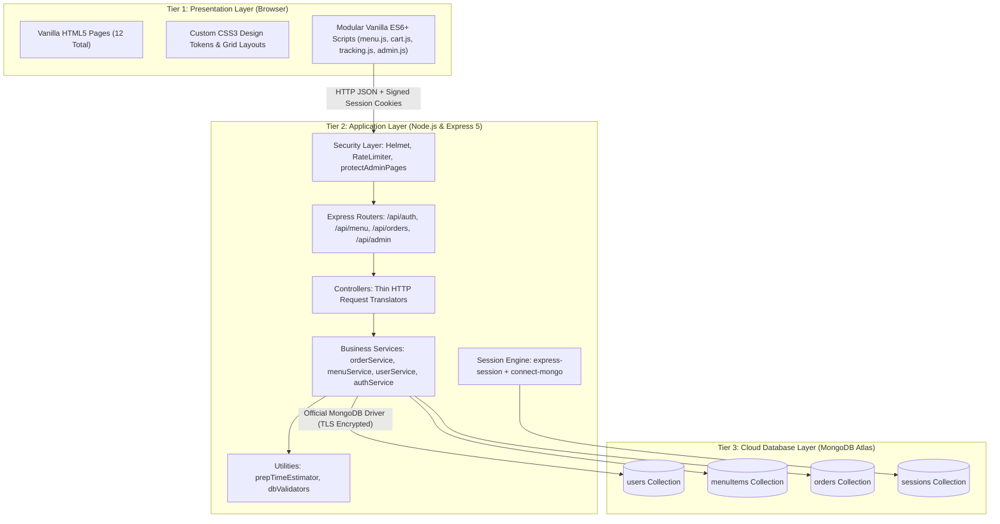
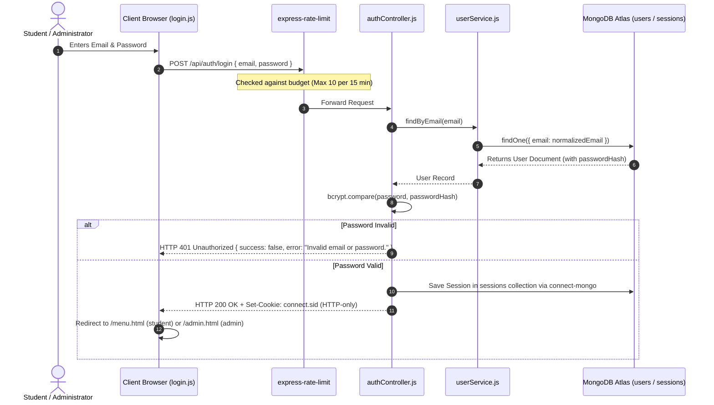
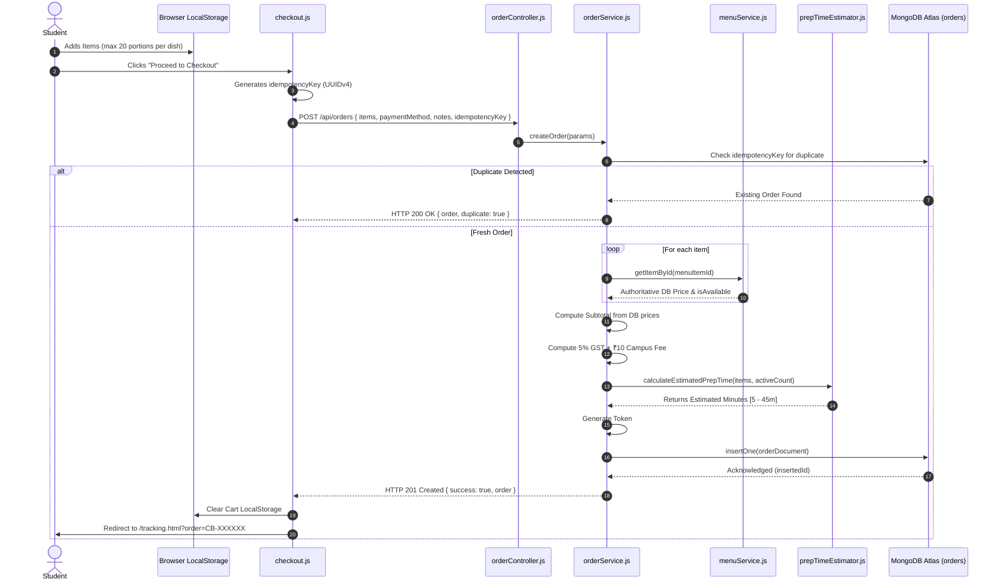
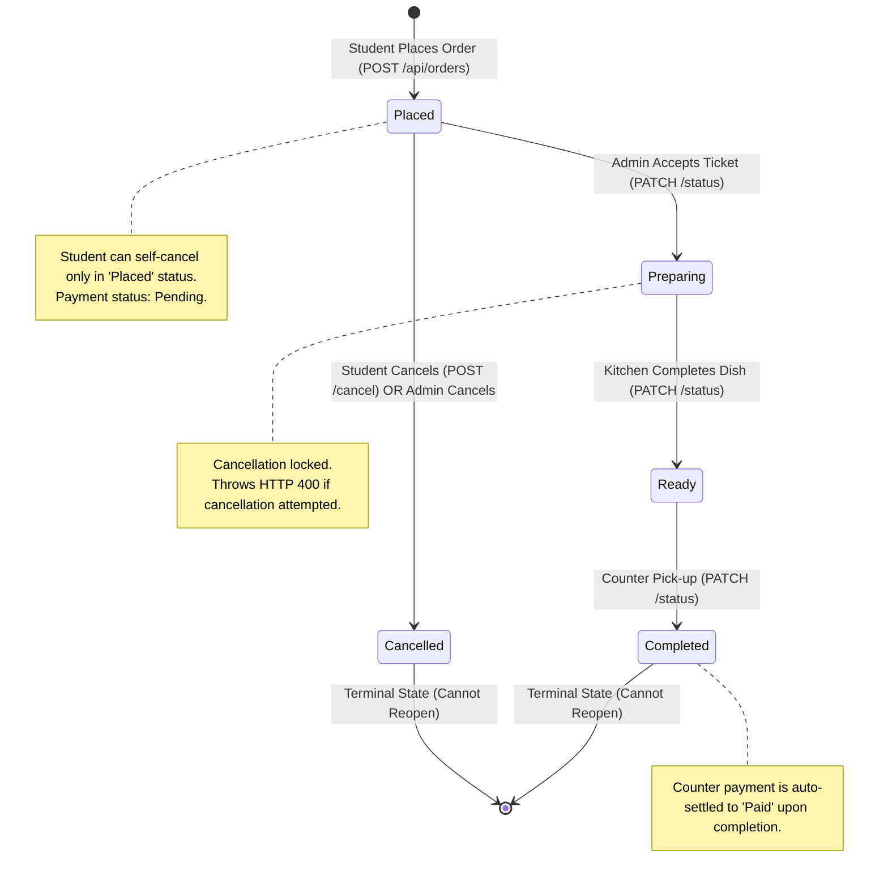
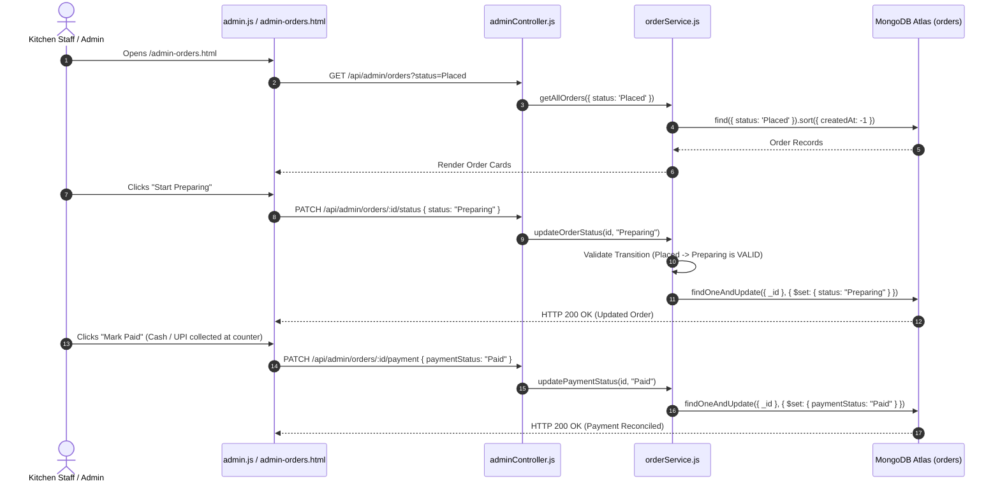

# CampusBite — System Architecture Documentation

This document describes the architectural design, communication protocols, request lifecycles, and component interactions of the **CampusBite Smart Canteen Ordering System**.

---

## 1. Architectural Overview

CampusBite is engineered as a decoupled, multi-tiered web platform. It strictly adheres to course guidelines for **CSE326 (Web Technology)**, employing native web technologies without third-party frontend frameworks or heavyweight Object-Relational Mappers (ORMs).



---

## 2. Three-Tier Architectural Layers

### Tier 1: Presentation Layer
- **Environment**: Client web browser (Chrome, Firefox, Safari, Edge).
- **Core Technologies**: HTML5, CSS3, Vanilla JavaScript (ES6+).
- **Responsibilities**:
  - Semantic markup rendering for all 12 student and staff views.
  - Client-side state persistence for the active shopping cart via `window.localStorage`.
  - Responsive visual layout utilizing native CSS Grid, Flexbox, and CSS Custom Properties.
  - Asynchronous HTTP communications via `window.fetch()` with JSON payload serialization.
  - Periodic polling (4.5s intervals) for active kitchen order progression.

### Tier 2: Application Layer
- **Environment**: Node.js runtime (v18+) executing an Express.js (v5) HTTP server.
- **Responsibilities**:
  - Static file hosting for frontend assets from `public/`.
  - HTTP header hardening via `helmet` and IP request throttling via `express-rate-limit`.
  - Authentication verification and role-based access control (`student` vs `admin`).
  - Business rules enforcement: server-side pricing calculation, 5% GST calculation, ₹10 campus fee application, quantity limits (max 20), and idempotency deduplication.
  - Algorithmic preparation time calculation based on ordered dish baselines and active kitchen queue count.
  - State machine lifecycle transition validation.

### Tier 3: Database Layer
- **Environment**: MongoDB Atlas multi-region cloud cluster.
- **Client**: Official MongoDB Node.js Driver (`mongodb@7.8.0`).
- **Responsibilities**:
  - Document storage for users, menu items, orders, and sessions.
  - Unique index enforcement on `users.email` and `orders.orderNumber`.
  - Sparse compound index enforcement on `orders.userId` + `orders.idempotencyKey`.
  - Session document TTL expiration (automatic purge after 24 hours).

---

## 3. Core Workflows & Mermaid Diagrams

### 3.1 Authentication Workflow



---

### 3.2 Student Order Placement Workflow



---

### 3.3 Order Status Lifecycle State Machine

Order status transitions must strictly follow the allowed graph configured in `server/config/constants.js`:



---

### 3.4 Admin Order Management & Counter Reconciliation



---

## 4. Frontend-to-Backend Communication Protocol

1. **Protocol**: HTTP/1.1 over TCP with TLS encryption for cloud Atlas communication.
2. **Data Format**: `application/json` for all request bodies and API responses.
3. **Session Transport**: HTTP-only, SameSite=Lax signed cookies (`connect.sid`).
4. **Standard API Response Shape**:
   ```json
   {
     "success": true,
     "data": { ... }
   }
   ```
   Or upon failure:
   ```json
   {
     "success": false,
     "error": "Descriptive human-readable error message."
   }
   ```

---

## 5. Security & Threat Mitigation Architecture

| Threat Vector | Mitigation Strategy | Component Enforcing Rule |
|---|---|---|
| **Client-side Price Tampering** | Discard submitted client price; fetch official price from MongoDB Atlas. | `orderService.js` |
| **Double-Click Duplicate Orders** | Enforce UUID idempotency check with compound sparse index in MongoDB. | `orderService.js` & `orders.js` |
| **Credential Theft & Brute Force** | 10 attempts / 15-minute window rate limit; bcrypt hashing with 10 rounds. | `auth.js` (routes) & `authService.js` |
| **Session Hijacking / XSS** | Cookies flagged `httpOnly: true`; Helmet Content Security Policy (CSP). | `server.js` |
| **Cross-Student Data Leaks** | Ownership check verifies `String(order.userId) === String(req.session.user.id)`. | `orderService.js` |
| **Unauthorized Admin Escalation** | Middleware `requireAdmin` checks `req.session.user.role === 'admin'`. | `server/middleware/auth.js` |
